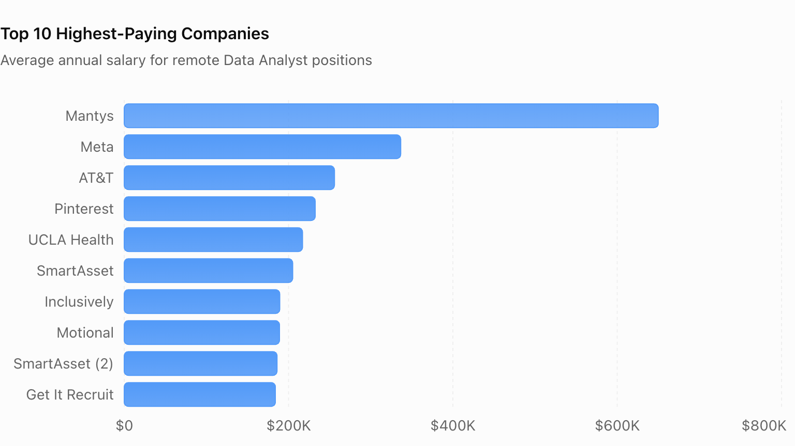

# Introduction
## Project Introduction

This project provides valuable insights into the data job market by analyzing and combining data from multiple tables. It explores the highest-paying data analyst jobs, top-paying skills, most in-demand skills, and the relationship between skill demand and salary.

By identifying skills that are both highly demanded and well-compensated, this project helps uncover valuable career opportunities and provides a clearer understanding of which technical skills can improve career prospects in the data analytics field.

The analysis uses SQL to explore job postings, salary information, companies, and associated skills, transforming raw data into meaningful insights to support informed career decisions.

Check SQL queries here [project_sql folder](/project_sql/ )
# Background
### The questions I wanted to answer through my sql queries were:
1. What are the top paying Data Analyst jobs salaries and associated companies?
2. What skills are required for this top paying jobs?
3. What skills are most in demand for data Analysts?
4. what are the most optimal skills to learn, which has more demand and higher salaries?

# Tools & Technologies Used

- **SQL** – Used to query, analyze, and extract insights from the database.
- **PostgreSQL** – Database management system used to store and manage the data.
- **Visual Studio Code (VS Code)** – Used for database management and executing SQL queries.
- **Git & GitHub** – Used for version control, tracking changes, and sharing SQL scripts and project analysis.

# The Analysis

This section outlines the approach, SQL queries, and analytical methods used to answer each business question and uncover meaningful insights from the data.

### 1. Top-Paying Companies for Data Analyst Roles

To identify the top-paying companies, I first filtered the job postings for remote Data Analyst positions with non-null salary information. I then joined the job postings table with the company dimension table to retrieve the associated company names and identify the companies offering the highest salaries.
```sql
     select 
            c.name as company_name,
            j.salary_year_avg
     from job_postings_fact as j 
     LEFT JOIN company_dim as c
               ON c.company_id = j.company_id

     WHERE j.job_title_short = 'Data Analyst' 
       and j.salary_year_avg is not NULL 
       and j.job_work_from_home = TRUE
    
     order by j.salary_year_avg desc
     limit 10;
```

*Bar graph visualizing the top 10 highest-paying Data Analyst jobs by company. This graph was generated using ChatGPT.*

Key insights:
- Mantys offers the highest listed average salary at $650,000.
- Meta ranks second at $336,500.
- SmartAsset appears twice with different salary records.
- All salaries are annual averages in USD.

### 2. Skills for top paying jobs


# What I Learned

# Conclusion 
